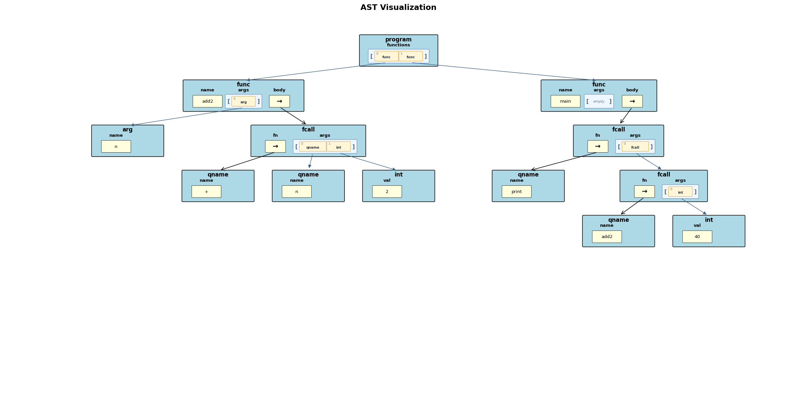
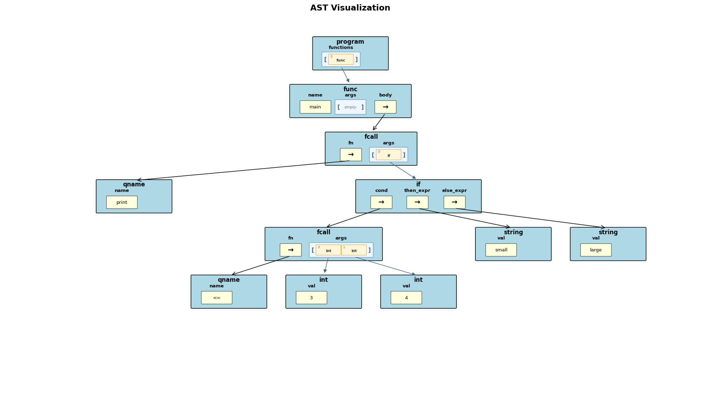
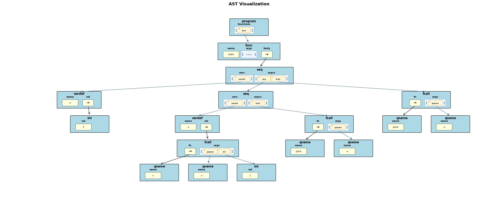
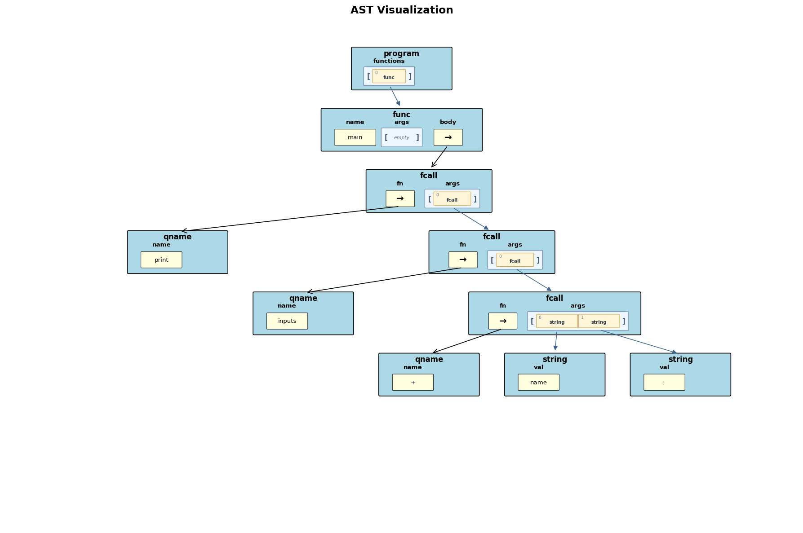

# Project #2: Brewin v2 Lisp-like Interpreter

CS 131 Fall 2026

Due date: Oct 19, noon

## Important Info

Project #2 builds directly on the Project #1 Brewin spec. This document should
be read as the Project #2 extension spec: unless a behavior is changed or newly
introduced here, the Project #1 spec remains in force.

The lexer and parser are still provided. Your job is to implement the Project #2
interpreter in `interpreterv2.py`.

Your Gradescope score is your final score. You may submit to Gradescope as many
times as you like before the deadline, and the last submission score is the
score you will receive on the assignment.

Use Barista for "what if" questions. Barista is the reference interpreter for
program behavior, including output and required runtime error type.

## Links

- Barista: [https://cs131-barista.fly.dev](https://cs131-barista.fly.dev)
- Project #1 spec: [proj1-26.md](../p1spec/proj1-26.md)

## Table of Contents

- [Introduction](#introduction)
- [Project 1 Baseline](#project-1-baseline)
- [Project 2 Feature Summary](#project-2-feature-summary)
- [What Do You Need To Do For Project 2](#what-do-you-need-to-do-for-project-2)
- [Function Definitions And Calls](#function-definitions-and-calls)
- [Function Return Values](#function-return-values)
- [Booleans](#booleans)
- [Conditionals](#conditionals)
- [Boolean Not](#boolean-not)
- [Comparisons](#comparisons)
- [String Concatenation](#string-concatenation)
- [`inputi` Prompt Formatting](#inputi-prompt-formatting)
- [`inputs`](#inputs)
- [`print` Changes](#print-changes)
- [`seq` And Scoping Changes](#seq-and-scoping-changes)
- [Program Evaluation Changes](#program-evaluation-changes)
- [AST Changes](#ast-changes)
- [AST Visualizations](#ast-visualizations)
- [Required New And Changed Failure Modes](#required-new-and-changed-failure-modes)
- [What We Will And Will Not Test](#what-we-will-and-will-not-test)
- [Coding Requirements](#coding-requirements)
- [Deliverables](#deliverables)
- [Grading](#grading)
- [Academic Integrity](#academic-integrity)

## Introduction

In this project, you will extend the Brewin interpreter to support larger
expression-oriented programs. Brewin v2 keeps the same square-bracketed prefix
syntax from Project #1, but programs may now define and call multiple functions,
use boolean values, choose between expressions with `if`, compare values, and
read string input.

Here is a complete Project #2 program:

```brewin
[func fact [n]
  [if [<= n 1]
      1
      [* n [fact [- n 1]]]]]

[func main [] [print [fact 5]]]
```

It prints:

```text
120
```

The Project #1 spec already explains the basic syntax, parser, `Element` class,
integer and string literals, ordinary function-call AST shape, `seq` syntax,
`print`, `inputi`, arithmetic, and the general runtime error mechanism. This
document focuses on the Project #2 differences.

## Project 1 Baseline

All unchanged Project #1 behavior remains required in Project #2. In particular,
students should already know from the Project #1 spec how to:

- parse a program with `parse_program(program)`;
- inspect AST nodes with `elem_type` and `get(...)`;
- evaluate integer literals, string literals, variable references, function
  calls, arithmetic calls, and `seq` expressions;
- use `super().output(...)`, `super().get_input()`, and `super().error(...)`;
- preserve earlier output when a later runtime error occurs;
- handle Project #1 required errors, unless this spec explicitly changes the
  rule.

This spec intentionally does not repeat those rules in full. When a Project #2
rule differs from Project #1, the changed behavior is called out below.

## Project 2 Feature Summary

Brewin v2 adds these features:

- multiple function definitions in one program;
- user-defined functions with zero or more parameters;
- recursive function calls;
- boolean values `#t` and `#f`;
- `if` expressions;
- boolean-not expressions with `!`;
- equality and ordering comparisons;
- string concatenation with `+`;
- string input with `inputs`;
- boolean-aware prompt formatting for `inputi` and `inputs`;
- nested lexical scopes for `seq`;
- a changed return value for `print`.

## What Do You Need To Do For Project 2

Create a class named `Interpreter` in `interpreterv2.py`. It must inherit from
`InterpreterBase` and implement at least:

```python
class Interpreter(InterpreterBase):
    def __init__(self, console_output=True, inp=None, trace_output=False):
        ...

    def run(self, program):
        ...
```

## Function Definitions And Calls

Project #1 programs had exactly one usable function: zero-argument `main`.
Project #2 programs may define one or more additional functions.

The function definition source form is the same AST form you saw in Project #1:

```brewin
[func function_name [parameter_name1 parameter_name2 ...] body_expression]
```

The important Project #2 changes are:

- The program may contain multiple function definitions.
- A non-`main` function name is legal.
- A function may have zero or more formal parameters.
- Each function name may be defined only once; it is an error to redefine two
  functions with the same name.
- Formal parameter names must be unique within a given function definition.
- Function definitions may appear before or after the functions that call them.
- A function call may call a built-in function like `print`, an operator like
  `+`, or a user-defined function.
- A user-defined function call must pass exactly the number of arguments listed
  in that called function's definition.
- A user-defined function call creates a fresh function scope.
- A called function cannot see the caller's local variables.
- Recursive function calls must work.

Example:

```brewin
[func avg [x y] [/ [+ x y] 2]]
[func main [] [print [avg 1 3]]]
```

This prints:

```text
2
```

Function names are unique among user-defined functions only. Defining a
user-defined function named `print`, `inputi`, or `inputs` is legal, but calls to
those names still resolve to the built-in functions. Built-in functions and
operators have priority over user-defined functions during call resolution.

If a name in call position (`fn` in a `fcall` node) is currently bound as a
variable in the active function scope, the call is treated as using a variable
as a function and must report `ErrorType.TYPE_ERROR`, even if the same spelling
is also a built-in or user-defined function name.

Arguments are evaluated in the caller before a called function begins running.
For every function call node, argument expressions are evaluated from left to
right before arity checks, call-name resolution errors, variable-as-function
errors, or computed-call errors are reported. Any output, input consumption, or
runtime error produced while evaluating an earlier argument happens before those
call validation checks. When a user-defined function is called, each of its
formal parameters is associated with the value of the argument/expression being
passed in.

## Function Return Values

Every function returns the value produced by its body expression.

```brewin
[func add2 [x] [+ x 2]]
[func main [] [print [add2 40]]]
```

The body of `add2` evaluates to `42`, so `[add2 40]` returns `42`.

The value returned by `main` is ignored by `run(...)`, just as in Project #1.

## Booleans

Brewin v2 adds a boolean type with two literal values:

```brewin
#t
#f
```

The parser represents these as `bool` AST nodes whose `val` fields are Python
`True` and Python `False`.

Booleans are their own type. They are not integers, even though Python's `bool`
type is related to `int`. Use exact type checks when enforcing integer-only or
boolean-only operations.

## Conditionals

Brewin v2 adds an `if` expression:

```brewin
[if condition_expression then_expression else_expression]
```

The condition must evaluate to a boolean. If it evaluates to `#t`, the
`then_expression` is evaluated and returned. If it evaluates to `#f`, the
`else_expression` is evaluated and returned.

Only the selected branch is evaluated. The unselected branch must not produce
output, consume input, or report errors.

Example:

```brewin
[func abs [n]
  [if [< n 0]
      [- 0 n]
      n]]

[func main [] [print [abs [- 0 5]]]]
```

This prints:

```text
5
```

## Boolean Not

Brewin v2 adds boolean not:

```brewin
[! expression]
```

The operand must evaluate to a boolean. The result is the opposite boolean.

Examples:

```brewin
[! #t]  /* evaluates to #f */
[! #f]  /* evaluates to #t */
```

## Comparisons

Brewin v2 adds comparison operators. Each comparison operator takes exactly two
arguments and returns a boolean.

Equality comparisons:

```brewin
[== left right]
[!= left right]
```

For `==` and `!=`, both operands must have the same exact type, and that type
must be integer, string, or boolean, otherwise a type error must be generated.

Examples:

```brewin
[== 3 3]        /* #t */
[== 3 4]        /* #f */
[!= "a" "b"]    /* #t */
[== #t #t]      /* #t */
[== #t 1]       /* generates a TYPE_ERROR */
```

Ordering comparisons:

```brewin
[< left right]
[<= left right]
[> left right]
[>= left right]
```

For ordering comparisons, both operands must have the same exact type, and that
type must be integer or string. Integer comparisons use numeric ordering. String
comparisons use Python's lexicographic string ordering.

Examples:

```brewin
[< 1 5]         /* #t */
[>= 3 3]        /* #t */
[< "a" "b"]     /* #t */
[>= "b" "a"]    /* #t */
[>= "a" 1]      /* TYPE_ERROR */
```

## String Concatenation

Project #1 required `+` only for integer addition. Brewin v2 also allows `+` on
two strings:

```brewin
[+ "hello, " "world"]
```

This evaluates to:

```text
hello, world
```

The complete Project #2 rule for `+` is:

- two integers produce integer addition;
- two strings produce string concatenation;
- all other operand combinations are type errors.

The rules for `-`, `*`, and `/` are unchanged from Project #1.

## `inputi` Prompt Formatting

The source forms and return behavior of `inputi` are otherwise unchanged from
Project #1:

```brewin
[inputi]
[inputi prompt_expr]
```

Project #2 changes prompt formatting. If `inputi` has one argument, that
argument is evaluated first, formatted using Brewin v2 output formatting, and
output as a prompt using `super().output(...)`. Brewin v2 output formatting
means:

- booleans print as `#t` or `#f`;
- integers and strings print with Python's `str(...)`.

For example:

```brewin
[func main [] [print [inputi #t]]]
```

With input `12`, this prints:

```text
#t
12
```

## `inputs`

Brewin v2 adds a built-in string input function called `inputs`:

```brewin
[inputs]
[inputs prompt_expr]
```

`inputs` behaves like `inputi`, except it returns the input as a string instead
of converting it to an integer.

If `inputs` has one argument, that argument is evaluated first, formatted using
Brewin v2 output formatting, and output as a prompt using `super().output(...)`.

Example:

```brewin
[func main [] [print [inputs "Type a string:"]]]
```

If the input is `ok`, the output is:

```text
Type a string:
ok
```

If `super().get_input()` returns `None`, `inputs` returns the empty string `""`.

## `print` Changes

Project #1 specified that `print` returns `0`. In Brewin v2, `print` MUST return `#t`.

Example:

```brewin
[func main []
  [seq [[p [print [+ 4 5]]]]
    [print p]]]
```

This prints:

```text
9
#t
```

Brewin v2 also adds boolean output formatting:

- `#t` prints as `#t`;
- `#f` prints as `#f`.

## `seq` And Scoping Changes

The source form and basic evaluation order of `seq` are unchanged from Project
#1. The important Project #2 change is the variable environment.

In Project #1, the spec allowed a simple interpreter-wide variable environment.
In Brewin v2, each function call has its own function scope, and each evaluated
`seq` creates a nested lexical scope inside the current function call.

Variable lookup searches from the innermost active `seq` scope outward within
the current function call. It does not search the caller's function scope.

Example:

```brewin
[func main []
  [seq [[x 10]]
    [seq [[y 20]]
      [print x]
      [print y]]]]
```

This prints:

```text
10
20
```

In the example above, the inner `seq` can see/use the outer `x`, and its own
local `y` is visible only inside that inner scope.

An inner `seq` may define a variable with the same name as an outer variable or
formal parameter. The inner variable "shadows" the outer one while the inner scope
is active. Another example shows this:

```brewin
[func main []
  [seq [[x 5]]
    [seq [[x [+ x 1]]]
      [print x]]
    [print x]]]
```

This prints:

```text
6
5
```

The initializer `[+ x 1]` in the inner `seq` sees the outer `x`, because the
inner `x` is not defined until after its initializer has been evaluated.

A duplicate variable name in the same `seq` scope is still a name error.
An outer `seq` referring to a variable from an inner `seq` is also an error,
since a `seq`'s variables go out of scope once the `seq` completes.

A called function cannot see the caller's locals:

```brewin
[func f [] x]

[func main []
  [seq [[x 10]]
    [f]]]
```

Calling `[f]` reports `ErrorType.NAME_ERROR`, because `f` has its own function
scope and cannot see the local variables in the caller (`main`).

## Program Evaluation Changes

When `run(program)` is called, a Project #2 interpreter should:

1. Reset output, input, error state, and any interpreter state from earlier runs.
2. Parse the source program with `parse_program(program)`.
3. Load all function definitions before running `main`.
4. Report `ErrorType.NAME_ERROR` if two function definitions have the same name.
5. Report `ErrorType.NAME_ERROR` if any function repeats a formal parameter name.
6. Report `ErrorType.NAME_ERROR` if no `main` function exists.
7. Report `ErrorType.NAME_ERROR` if `main` has any parameters.
8. Create a fresh function scope for `main`.
9. Evaluate the body expression of `main`.

The value returned by `main` is ignored. Any output produced during evaluation
must still be recorded with `InterpreterBase.output()`, including output that
happens before a later runtime error.

## AST Changes in Project #2

Most Project #1 AST node shapes are unchanged. The following nodes are new or
have new Project #2 meaning.

### Program Node

The `program` node still has a `functions` field, but that list may now contain
more than one function definition node.

### Function Definition Node

The `func` node still has:

```text
name: string
args: list of argument nodes
body: expression node
```

The Project #2 change is that non-`main` functions are legal, and `args` may
contain zero or more `arg` nodes.

### Argument Node

An `arg` node represents one formal parameter:

```text
elem_type: "arg"
dict:
  name: string
```

Project #1 did not require you to support function parameters. Project #2 does.

### Boolean Literal Node

Boolean literals are represented as:

```text
elem_type: "bool"
dict:
  val: bool  # either True or False
```

### If Node

An `if` expression is represented as:

```text
elem_type: "if"
dict:
  cond: expression node
  then_expr: expression node
  else_expr: expression node
```

### Not Node

A `!` expression is represented as:

```text
elem_type: "not"
dict:
  op1: expression node
```

### Function Call Node

The `fcall` node shape is unchanged, but it can now represent more callable
names:

- user-defined functions (like `fact`);
- `inputs`;
- comparison operators: `==`, `!=`, `<`, `<=`, `>`, `>=`;
- string concatenation via `+`.

Project #2 only supports calls whose `fn` field is a `qname` node. If the `fn`
field is any other expression node, the call is a computed call. The `fn`
expression itself is not evaluated for computed calls; the interpreter must
report `ErrorType.TYPE_ERROR` after the call's argument expressions have been
evaluated from left to right.

### Sequence Node

The `seq` node shape is unchanged. The Project #2 change is runtime scoping: a
`seq` creates a nested lexical scope that disappears when the `seq` finishes running.

## AST Visualizations

The provided parser can still plot ASTs. These examples focus on Project #2
constructs.

Two functions, including a user-defined function call:

```brewin
[func add2 [n] [+ n 2]]
[func main [] [print [add2 40]]]
```



An `if` expression nested inside `print`:

```brewin
[func main []
  [print [if [<= 3 4] "small" "large"]]]
```



Nested `seq` expressions demonstrating Project #2 shadowing:

```brewin
[func main []
  [seq [[x 1]]
    [seq [[x [+ x 1]]] [print x]]
    [print x]]]
```



The new `inputs` built-in with a computed prompt:

```brewin
[func main [] [print [inputs [+ "name" ": "]]]]
```



## Required New And Changed Failure Modes

All Project #1 required errors must be handled unless the rule is explicitly
changed here. This table lists only Project #2 additions or changes.

For every row, report the listed error type by calling
`super().error(required_type, ...)`. The exact error message string is not graded.

| New or changed situation | Required error type |
| --- | --- |
| A duplicate non-`main` function name is defined | `ErrorType.NAME_ERROR` |
| A function definition repeats a formal parameter name | `ErrorType.NAME_ERROR` |
| A user-defined function is called with too few arguments | `ErrorType.NAME_ERROR` |
| A user-defined function is called with too many arguments | `ErrorType.NAME_ERROR` |
| `inputs` is called with more than one argument | `ErrorType.NAME_ERROR` |
| A duplicate variable name is defined in the same `seq` scope | `ErrorType.NAME_ERROR` |
| An `if` condition is not boolean | `ErrorType.TYPE_ERROR` |
| `!` is used on a non-boolean value | `ErrorType.TYPE_ERROR` |
| `==` compares operands of different types | `ErrorType.TYPE_ERROR` |
| `!=` compares operands of different types | `ErrorType.TYPE_ERROR` |
| `<`, `<=`, `>`, or `>=` compares operands of different types | `ErrorType.TYPE_ERROR` |
| `<`, `<=`, `>`, or `>=` is used on booleans | `ErrorType.TYPE_ERROR` |
| `+` is used with operands that are neither two integers nor two strings | `ErrorType.TYPE_ERROR` |
| A comparison operator has the wrong number of arguments in the AST | `ErrorType.NAME_ERROR` |
| A variable is used as a function | `ErrorType.TYPE_ERROR` |
| A computed call is attempted | `ErrorType.TYPE_ERROR` |

The following Project #1 errors are intentionally not repeated in the table:
missing `main`, duplicate `main`, `main` with parameters, undefined variables,
undefined function calls, `inputi` with too many arguments, arithmetic
wrong-argument-count errors, and integer arithmetic type errors for `-`, `*`,
and `/`. They still must be handled correctly.

These Project #1 failure rules are changed:

- Defining a function other than `main` is now legal.
- Defining a variable in an inner `seq` with the same name as a variable in an
  outer seq is now legal.
- Adding two strings with `+` is now legal.

## What We Will And Will Not Test

Project #1 testing assumptions still apply unless changed here. Expect tests for:

- multiple function definitions;
- function calls to functions defined before and after the calling function's
  definition;
- zero-argument and multi-argument user-defined functions;
- recursive functions;
- boolean literals and boolean output;
- `if` expressions, including branch laziness;
- `!` expressions;
- comparison operators;
- `+` used for string concatenation;
- `inputs`, with and without prompts;
- nested lexical scopes and shadowing;
- the Project #2 failure modes listed above.

We will continue to assume syntactically valid programs.

## Coding Requirements

The Project #1 coding requirements still apply. Project #2-specific requirements
are:

- Your interpreter source file must be named `interpreterv2.py`.
- The file must define a class named `Interpreter`.
- `Interpreter` must inherit from `InterpreterBase`.
- `Interpreter` must implement `run(self, program)`.
- `Interpreter` must support the constructor signature used by the test harness.
- Do not modify `intbase.py`, `brewlex.py`, `brewparse.py`, or `element.py`.
- Use Python 3.11 and only the Python standard library.

## Deliverables

Submit:

- `interpreterv2.py`;
- `readme.txt`, indicating known issues or saying "all good";
- any additional Python source modules used by `interpreterv2.py`.

Do not submit the provided parser, lexer, AST element class, or base interpreter
class.

## Grading

Your score is determined by your interpreter's ability to run Brewin v2 programs
correctly and report required errors with the correct `ErrorType`.

Use the local test harness regularly while developing. You should also write
your own tests for the new Project #2 features.

We will grade using Python 3.11.

## Academic Integrity

Follow the course academic integrity policy. Do not copy another student's
interpreter, share your completed interpreter, or publish your solution in a
public repository before the end of the quarter.

Allowed activities include discussing general concepts, asking course staff
conceptual questions, and sharing test cases if permitted by course policy.
