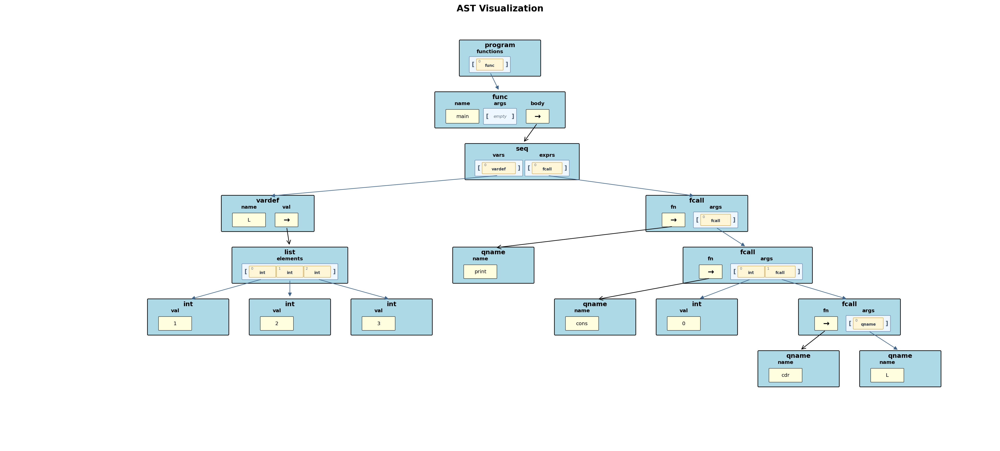
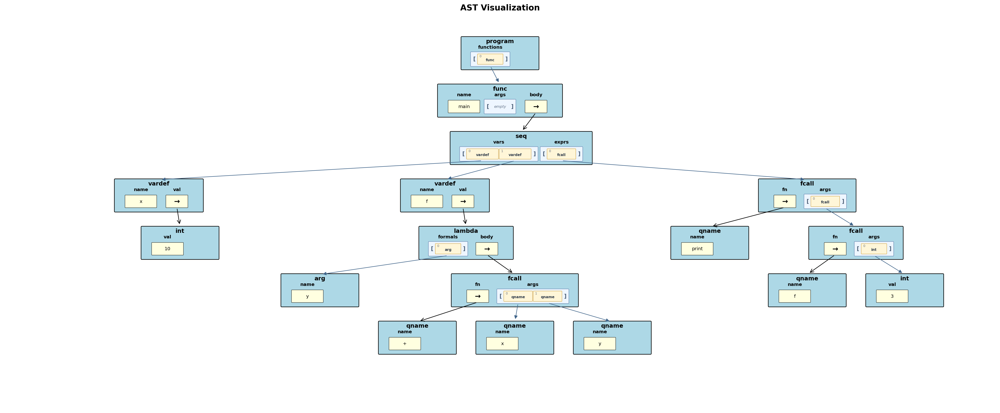
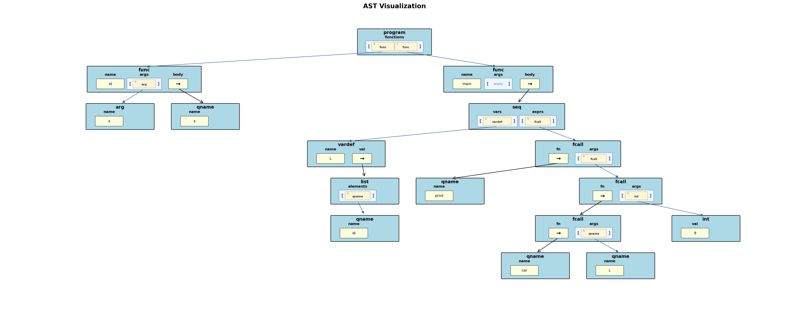
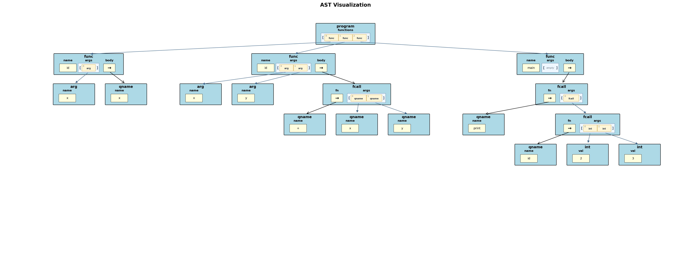
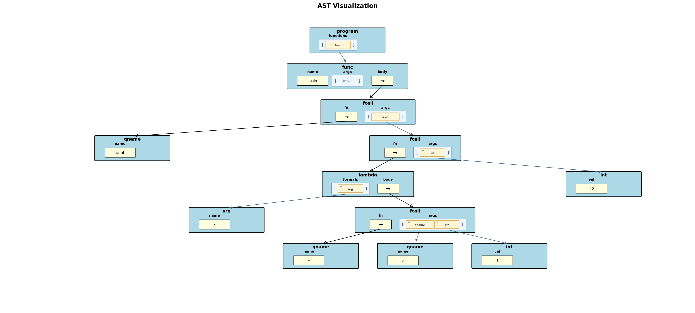

# Project #3: Brewin++  

CS 131 Fall 2026

Due date: November 9, 2026 at 12pm (noon)

## Important Info

In this project, you will build the third version of the Brewin interpreter.
Brewin++ is still a small Lisp-like language with square-bracketed prefix
syntax, but it now has the pieces needed to write more functional-style
programs: lists, lambdas, closures, first-class user-defined functions, and
function overloading by arity (number of arguments).

You are only required to implement `interpreterv3.py`. The lexer, parser, AST
node class, base interpreter class, and testing harness are provided. Do not
modify the provided lexer or parser to solve this project.

Your Gradescope score is your final score. You may submit to Gradescope as many
times as you like before the deadline, and the last submission score is the
score you will receive on the assignment.

Use Barista for "what if" questions. Barista is the reference interpreter for
program behavior, output formatting, and required runtime error type.

## Table of Contents

- [Introduction](#introduction)
- [What You Need To Build](#what-you-need-to-build)
- [Brewin++ Feature Summary](#brewin-feature-summary)
- [Values And Environments](#values-and-environments)
- [Function Overloading](#function-overloading)
- [First-Class User-Defined Functions](#first-class-user-defined-functions)
- [Function Calls](#function-calls)
- [Lambda Expressions And Closures](#lambda-expressions-and-closures)
- [Lists](#lists)
- [List Built-In Functions](#list-built-in-functions)
- [Printing And Input](#printing-and-input)
- [AST Node Reference](#ast-node-reference)
- [AST Visualizations](#ast-visualizations)
- [Required Error Conditions](#required-error-conditions)
- [What We Will And Will Not Test](#what-we-will-and-will-not-test)
- [Coding Requirements](#coding-requirements)
- [Deliverables](#deliverables)
- [Grading](#grading)
- [Academic Integrity](#academic-integrity)

## Introduction

The Brewin standards body (aka Carey and Tobias) has met and identified a bunch of new improvements to the Brewin language - so many, in fact that they want to update the language’s name to Brewin++. In this project, you will be updating your Brewin interpreter so it supports these new Brewin++ features. As before, you’ll be implementing your interpreter in Python, and you may solve this problem using either your original Project #2 solution, or by modifying the Project #2 solution that we will provide (see below for more information on this). 

Brewin++ keeps the expression-oriented style from Brewin, but it adds a real
functional-programming toolkit. The biggest new pieces are lists, lambdas,
closures, first-class user-defined functions, computed function calls, and
function overloading by arity.

Lists are a new runtime type. A list is written with curly braces and may hold
any Brewin variables and values, including other lists, booleans, strings, integers, function
values, and lambdas. Brewin++ also provides the standard list operations as built-in functions including: 
`car`, `cdr`, `cons`, `append`, and `length`.

For example:

```brewin
[func main []
  [seq [[xs {1 2 3}]
        [ys [cons 0 xs]]]
    [print ys]
    [print [length ys]]]]
```

This prints:

```text
{0 1 2 3}
4
```

Another important new idea in Brewin++ is that user-defined functions can be treated as
values. You can pass a user-defined function to another function, store it in a
variable, put it inside a list, return it from a function, and call it later.

For example:

```brewin
[func applytwice [f x] [f [f x]]]
[func inc [n] [+ n 1]]
[func main [] [print [applytwice inc 4]]]
```

This prints:

```text
6
```

The name `inc` is used as a value when it is passed to `applytwice`. Inside
`applytwice`, the parameter `f` holds a reference to that function, so `[f x]` calls the
function, `inc`, that was passed in.

Brewin++ also adds lambda expressions. A lambda is an unnamed function value
that can capture variables from the surrounding lexical environment:

```brewin
[func main []
  [seq [[x 10]
        [addx [lambda [y] [+ x y]]]]
    [print [addx 3]]]]
```

This prints:

```text
13
```

The lambda captures the `x` and its value as it existed when the lambda was created.

Finally, v3 allows overloaded functions, where multiple functions have the same
name but different numbers of parameters:

```brewin
[func choose [x] x]
[func choose [x y] y]
[func main []
  [seq []
    [print [choose 10]]
    [print [choose 10 20]]]]
```

This prints:

```text
10
20
```

The rest of this spec explains these features in detail and documents every
runtime error your interpreter must report.

## What You Need To Build

Create a class named `Interpreter` in `interpreterv3.py`. It must inherit from
`InterpreterBase` and support the constructor shape used by the test harness:

```python
class Interpreter(InterpreterBase):
    def __init__(self, console_output=True, inp=None, trace_output=False):
        ...

    def run(self, program):
        ...
```

The `program` argument to `run` is a Python string containing a complete Brewin++
program. Your `run` method should call the provided parser:

```python
from brewparse import parse_program

ast = parse_program(program)
```

You may assume all official test programs are syntactically valid. Runtime
errors are your interpreter's responsibility; syntax errors are not.

## Brewin++ Feature Summary

Brewin++ includes all required Brewin v2 behavior unless this document says
otherwise. The new Brewin++ features are:

- list literals using curly braces, such as `{1 2 3}`;
- list operations: `car`, `cdr`, `cons`, `append`, and `length`;
- lambda expressions using `[lambda [params...] body]`;
- closures, so lambdas remember surrounding local variables;
- first-class functions that can be passed, stored in variables/lists, returned, etc.;
- computed function calls, such as `[[lambda [x] [+ x 1]] 40]`;
- function overloading by arity.

Here is a short program using several of these features:

```brewin
[func mapone [f xs]
  [if [== [length xs] 0]
      {}
      [cons [f [car xs]] [mapone f [cdr xs]]]]]

[func main []
  [seq [[add1 [lambda [x] [+ x 1]]]]
    [print [mapone add1 {10 20 30}]]]]
```

This prints:

```text
{11 21 31}
```

## Values And Environments

Your interpreter needs to represent six kinds of runtime values:

- integer values;
- string values;
- boolean values;
- list values;
- user-defined function values;
- lambda values.

Lists may contain any Brewin value. These are all legal list values:

```brewin
{1 "two" #t}
{{1 2} {3 4}}
{[lambda [x] [* 2 x]] "foo"}
```

A user-defined function value represents a named function in the program. A
lambda value is a closure: its parameter list and all in-scope variables and their values are captured when the lambda expression was evaluated.

### Variable Scopes

The `seq` and function scoping rules from Brewin v2 still apply as-is.

Lambdas use a similar lexical scoping approach, but with one important
difference: a lambda has three scopes:
 
1. The variables and their values that it captured when it was first created from the enclosing scope
2. Then the lambda's formal parameters, which can shadow the captured variables
3. Then any local variables define in `seq`s within the lambda, which shadow both of the above

## Function Overloading

In Brewin++, multiple functions may have the same name as long as they have different
numbers of parameters. This is called overloading by arity.

```brewin
[func foo [x] x]
[func foo [x y] [+ x y]]

[func main []
  [seq []
    [print [foo 5]]
    [print [foo 3 3]]]]
```

This prints:

```text
5
6
```

The call `[id 5]` has one argument, so it calls the one-parameter version of `foo`. The call
`[id 3 3]` has two arguments, so it calls the two-parameter version of `foo`.

These rules must be enforced:

- Two function definitions with the same name and same number of parameters are
  duplicates and result in a ErrorType.NAME_ERROR, even if the parameter names differ.
- Two function definitions with the same name and different numbers of
  parameters are legal overloads.
- Function definitions may appear before or after functions that call them.
- Named functions do not capture caller locals. They always run in a fresh
  function scope containing only their formal parameters.

If a program defines a `main` with one or more parameters, e.g., `[func main [x] ...]` but does not define `[func main []
...]`, then there is no valid entry point and `run()` must report `ErrorType.NAME_ERROR`.

## First-Class User-Defined Functions

In Brewin++, if code references a user-defined function's name in an expression and there
is no local variable with that name that shadows the function's name, then that name evaluates to a function value.

```brewin
[func foo [n] [+ n 1]]
[func main []
  [seq [[var foo]]  /* foo is evaluated as a value representing the function foo's code */
    [print [var 41]]]]  /* now we can call the function foo through var */
```

This prints:

```text
42
```

The expression `foo` in `[[var foo] ...]` evaluates to a function value, which is
stored in the local variable `var`. The call `[var 41]` invokes that function value.

Function values are especially useful with lists:

```brewin
[func id [x] x]
[func main []
  [seq [[things {id [lambda [x] [+ x 1]]}]]
    [print [[car things] 8]]]]
```

This prints:

```text
8
```

Only user-defined functions are first-class in this project. Built-in functions
such as `print`, `inputi`, `inputs`, `car`, and `length` are directly callable,
but they do not become values when their names appear as ordinary expressions.
For example, trying to initialize a variable with `print` as a value is a name
error unless the program also defines a user function named `print`.

Local variables shadow function names. In this program, `f` inside `main` refers
to the local integer, not the global function:

```brewin
[func f [x] [+ x 1]]
[func main []
  [seq [[f 10]]
    [print f]]]
```

This prints:

```text
10
```

If the same local variable is used in call position, the interpreter attempts to
call the local value. Since `10` is not callable, that is a type error:

```brewin
[func f [x] [+ x 1]]
[func main []
  [seq [[f 10]]
    [f 3]]]
```

The program above reports `ErrorType.TYPE_ERROR`.

## Function Calls

The Brewin++ parser represents every function call with an `fcall` node whose `fn`
field is itself an expression. In earlier projects, the `fn` field was usually
just a `qname` node like `print` or `+`. In Brewin++, it can also be a variable, lambda
expression, another function call which returns a function value, or any expression that evaluates to a
callable value.

These are all legal calls:

```brewin
[inc 4]
[[lambda [x] [+ x 1]] 4]
[[car {inc}] 4]  /* assuming inc is a function which returns its parameter's value + 1 */
```

Function-call evaluation order is:

1. Evaluate every argument expression from left to right.
2. Determine the call target.
3. Invoke the target if it is callable.
4. Report an error if the target is not callable or no overload matches the
   argument count.

For a direct named call to some function X such as `[print 1 2]`, `[* 3 4]`, or `[fact 5]`, where X could be a built-in function like `print` or `+`, or any user-defined function, the call target is handled this way:

1. If there is a local variable named `X`, use that local value as the target.
2. Otherwise, if `X` is a built-in function or operator, call the built-in.
3. Otherwise, look for a user-defined function named `X` whose arity matches
   the number of evaluated arguments.

For a computed call such as `[[car funcs] 10]`, evaluate the `fn` expression to determine what user-defined function or lambda to call. The result must be a user-defined function value or a lambda value. Any other value in call position is a type error.

When a user-defined function value is called, overload resolution still happens
by arity. A function value stores the function name; the number of actual
arguments chooses the specific overload.

## Lambda Expressions And Closures

A lambda expression creates an anonymous function value:

```brewin
[lambda [parameter_name1 parameter_name2 ...] body_expression]
```

Examples:

```brewin
[lambda [] 99]
[lambda [x] [+ x 1]]
[lambda [x y] [if [< x y] x y]]
```

A lambda expression evaluates to a lambda value. It does not immediately run its
body. The body runs only when the lambda value is called.

```brewin
[func main []
  [print [[lambda [x] [+ x 1]] 40]]]
```

This prints:

```text
41
```

Lambda formal parameter names must be unique. A duplicate formal parameter name
is a name error when the lambda expression is evaluated.

### Closure Capture

When a lambda expression is defined, it captures the currently visible lexical
variable bindings. This is what lets a lambda keep using a variable after the
scope that created it has returned.

```brewin
[func make_adder [x]
  [lambda [y] [+ x y]]]

[func main []
  [seq [[add10 [make_adder 10]]]
    [print [add10 5]]]]
```

This prints:

```text
15
```

The lambda returned by `make_adder` captured the parameter `x`, whose value was
`10` for that call.

When a lambda is called, its parameters shadow captured variables with the same
name:

```brewin
[func main []
  [seq [[x 10]
        [f [lambda [x] x]]]
    [print [f 7]]]]
```

This prints:

```text
7
```

The lambda's parameter `x` shadows the captured outer `x`.

## Lists

Brewin++ adds list literals. Lists use curly braces, not square brackets and NO commas:

```brewin
{}
{1 2 3}
{"a" "b" "c"}
{{1 2} {3 4}}
```

A list literal contains zero or more expressions. The expressions are evaluated
from left to right when the list literal is defined, and the resulting values
become the list elements.

```brewin
[func main []
  [seq [[x 5]
        [xs {1 [+ x 1] "foo"}]]
    [print xs]]]
```

This prints:

```text
{1 6 foo}
```

Lists can contain mixed types, other lists, function values and lambda values. Lists are immutable.

List operations like `cons` create and return list values. They do not mutate an existing
list.  

## List Built-In Functions

Brewin++ adds five list built-ins.

### `car`

`car` returns the first element of a non-empty list:

```brewin
[car {10 20 30}]  /* evaluates to 10 */
```

Rules:

- `car` takes exactly one argument.
- The argument must be a list.
- The list must be non-empty; calling `car` on an empty list reports `ErrorType.FAULT_ERROR`.
- The returned value is the first element of the list.

### `cdr`

`cdr` returns a new list containing every element except the first:

```brewin
[cdr {10 20 30}]  /* evaluates to {20 30} */
[cdr {10}]        /* evaluates to {} */
```

Rules:

- `cdr` takes exactly one argument.
- The argument must be a list.
- The list must be non-empty; calling `cdr` on a list with < 1 items reports `ErrorType.FAULT_ERROR`.
- The returned value is a list.

### `cons`

`cons` returns a new list containing the new value prepended onto the old list:

```brewin
[cons 0 {1 2 3}]  /* evaluates to {0 1 2 3} */
```

Rules:

- `cons` takes exactly two arguments.
- The first argument may be any Brewin value.
- The second argument must be a list. If it is not you must generate a type error.
- The returned value is a new list whose first element is the first argument,
  followed by the elements of the second argument.

### `append`

`append` concatenates two lists:

```brewin
[append {1 2} {3 4}]  /* returns a new list with value {1 2 3 4} */
```

Rules:

- `append` takes exactly two arguments.
- Both arguments must be lists or you must generate a type error.
- The returned value is a new list containing the first list's elements followed
  by the second list's elements.

### `length`

`length` returns the number of top-level elements in a list:

```brewin
[length {}]          /* evaluates to 0 */
[length {10 20 30}]  /* evaluates to 3 */
[length {{1 2} 3}]   /* evaluates to 2 */
```

Rules:

- `length` takes exactly one argument.
- The argument must be a list.
- The returned value is an integer.

## Printing And Input

The v2 behavior of `print`, `inputi`, and `inputs` mostly remains in force.
The v3 changes are about formatting the new value types.

`print` accepts any number of arguments, including zero. It evaluates its
arguments from left to right, converts each value to its Brewin output form,
concatenates those strings with no extra spaces between arguments, outputs the
result using `super().output(...)`, and returns `#t`.

Output formatting is:

| Runtime value | Printed form |
| --- | --- |
| integer | decimal digits, such as `42` |
| string | the string contents, without quotation marks |
| boolean true | `#t` |
| boolean false | `#f` |
| empty list | `{}` |
| non-empty list | braces with one space between elements, such as `{1 #t hi}` |
| nested list | recursively formatted, such as `{{1 2} 3}` |

You will not be tested on printing out lambdas or function values.

`inputi` behaves the same in v3 as it did in v2.
`inputs` behaves the same in v3 as it did in v2.

## AST Node Reference

This section focuses on the AST node types that are new or changed in Brewin++. Nodes not
listed here behave the same in Brewin++ as they did in Brewin v2.

### Function Call Node

```text
elem_type: "fcall"
dict:
  fn: expression node
  args: list of expression nodes
```

The major Brewin++ change is that `fn` may be any expression node or a qname node. In a direct call like
`[print 1]`, it is a `qname`. In a computed call like `[[lambda [x] x] 5]`, it is a `lambda` node.

### List Node

```text
elem_type: "list"
dict:
  elements: list of expression nodes
```

Each child expression is evaluated left to right. The result is a list value
containing the evaluated element values.

### Lambda Node

```text
elem_type: "lambda"
dict:
  formals: list of arg nodes
  body: expression node
```

Evaluating a lambda node produces a lambda closure value. Calling that closure
later evaluates the `body`.

## AST Visualizations

The provided parser can plot ASTs. The following examples show the important
new v3 shapes.

List literals and list built-ins:

```brewin
[func main []
  [seq [[L {1 2 3}]]
    [print [cons 0 [cdr L]]]]]
```



A lambda expression that captures a surrounding variable:

```brewin
[func main []
  [seq [[x 10]
        [f [lambda [y] [+ x y]]]]
    [print [f 3]]]]
```



A user-defined function stored in a list and called after `car` returns it:

```brewin
[func id [x] x]
[func main []
  [seq [[L {id}]]
    [print [[car L] 9]]]]
```



Function overloading by arity:

```brewin
[func id [x] x]
[func id [x y] [+ x y]]
[func main [] [print [id 2 3]]]
```



A direct call to a lambda expression:

```brewin
[func main [] [print [[lambda [x] [+ x 1]] 40]]]
```



## Required Error Conditions

For every required runtime error, call `super().error(required_type, ...)`.
The exact message string is not graded. The required `ErrorType` is graded.

Earlier output must remain in the output log if a later expression reports an
error.

### Name Errors

| Situation | Required error type |
| --- | --- |
| No zero-argument `main` function exists | `ErrorType.NAME_ERROR` |
| A function definition repeats a formal parameter name | `ErrorType.NAME_ERROR` |
| Two functions have the same name and the same number of parameters | `ErrorType.NAME_ERROR` |
| A variable is used but is not in scope and is not a user-defined function name | `ErrorType.NAME_ERROR` |
| A built-in name such as `print`, `inputi`, `inputs`, `car`, `cdr`, `cons`, `append`, or `length` is used as a value rather than called directly | `ErrorType.NAME_ERROR` |
| A user-defined function name is called with an argument count for which no overload exists, but at least one overload with that name exists | `ErrorType.NAME_ERROR` |
| A call is made to an undefined named function | `ErrorType.NAME_ERROR` |
| A lambda expression repeats a formal parameter name | `ErrorType.NAME_ERROR` |
| A lambda value is called with too few or too many arguments | `ErrorType.NAME_ERROR` |
| `inputi` is called with more than one argument | `ErrorType.NAME_ERROR` |
| `inputs` is called with more than one argument | `ErrorType.NAME_ERROR` |
| `car` is called with anything other than one argument | `ErrorType.NAME_ERROR` |
| `cdr` is called with anything other than one argument | `ErrorType.NAME_ERROR` |
| `cons` is called with anything other than two arguments | `ErrorType.NAME_ERROR` |
| `append` is called with anything other than two arguments | `ErrorType.NAME_ERROR` |
| `length` is called with anything other than one argument | `ErrorType.NAME_ERROR` |
| `+`, `-`, `*`, `/`, `==`, `!=`, `<`, `<=`, `>`, or `>=` is encountered with the wrong number of arguments in an AST | `ErrorType.NAME_ERROR` |
| A duplicate variable name is defined in the same `seq` scope | `ErrorType.NAME_ERROR` |

### Type Errors

| Situation | Required error type |
| --- | --- |
| A call target evaluates to an integer, string, boolean, or list instead of a function value or lambda value | `ErrorType.TYPE_ERROR` |
| A local variable shadows a function name and the local value is not callable, but it is used in call position | `ErrorType.TYPE_ERROR` |
| An `if` condition is not boolean | `ErrorType.TYPE_ERROR` |
| `!` is used on a non-boolean value | `ErrorType.TYPE_ERROR` |
| `+` is used on anything other than two integers or two strings | `ErrorType.TYPE_ERROR` |
| `-`, `*`, or `/` is used on anything other than two integers | `ErrorType.TYPE_ERROR` |
| `==` or `!=` compares operands of different types | `ErrorType.TYPE_ERROR` |
| `==` or `!=` compares lists | `ErrorType.TYPE_ERROR` |
| `==` or `!=` compares user-defined function values | `ErrorType.TYPE_ERROR` |
| `==` or `!=` compares lambda values | `ErrorType.TYPE_ERROR` |
| `<`, `<=`, `>`, or `>=` is used on operands that are not both integers or both strings | `ErrorType.TYPE_ERROR` |
| `car` receives a non-list argument | `ErrorType.TYPE_ERROR` |
| `cdr` receives a non-list argument | `ErrorType.TYPE_ERROR` |
| The second argument to `cons` is not a list | `ErrorType.TYPE_ERROR` |
| Either argument to `append` is not a list | `ErrorType.TYPE_ERROR` |
| `length` receives a non-list argument | `ErrorType.TYPE_ERROR` |

### Fault Errors

| Situation | Required error type |
| --- | --- |
| `car` is called on an empty list | `ErrorType.FAULT_ERROR` |
| `cdr` is called on an empty list | `ErrorType.FAULT_ERROR` |

## What We Will And Will Not Test

Expect tests for:

- all v2 behavior that remains part of v3;
- function overloading by arity;
- duplicate overload detection;
- first-class user-defined functions;
- passing function values as parameters;
- returning function values;
- storing function values in lists;
- direct and indirect lambda calls;
- lambda closure capture;
- lambda parameter shadowing;
- duplicate lambda formal parameters;
- list literals, including empty and nested lists;
- `car`, `cdr`, `cons`, `append`, and `length`;
- list output formatting;
- function and lambda values stored and called through lists;
- every required error condition listed above.

You may assume:

- all programs are syntactically valid according to the provided parser;
- tests will use the parser and AST node classes we provide;
- tests will not require a particular behavior for division by zero;
- tests will check the `ErrorType`, not your exact error message.

## Coding Requirements

The Project #2 coding requirements still apply. Project #3-specific
requirements are:

- Your interpreter source file must be named `interpreterv3.py`.
- The file must define a class named `Interpreter`.
- `Interpreter` must inherit from `InterpreterBase`.
- `Interpreter` must implement `run(self, program)`.
- `Interpreter` must support the constructor signature used by the test
  harness.
- Do not modify `intbase.py`, `brewlex.py`, `brewparse.py`, `element.py`,
  `tester.py`, or `harness.py`.
- Use Python 3.11 and only the Python standard library.

You may add helper classes or helper functions inside `interpreterv3.py`. You
may also add additional Python source modules if your submitted interpreter
imports them, but your solution should not depend on changing the provided
infrastructure.

## Deliverables

Submit:

- `interpreterv3.py`;
- `readme.txt`, indicating known issues or saying "all good";
- any additional Python source modules used by `interpreterv3.py`.

Do not submit the provided parser, lexer, AST element class, base interpreter
class, or testing harness files.

## Grading

Your score is determined by your interpreter's ability to run Brewin++
programs correctly and report required errors with the correct `ErrorType`.

Use the local test harness regularly while developing. You should also write
your own tests for the new Project #3 features, especially combinations of
lists, lambdas, and first-class function values.

We will grade using Python 3.11.

## Academic Integrity

Follow the course academic integrity policy. Do not copy another student's
interpreter, share your completed interpreter, or publish your solution in a
public repository before the end of the quarter.

Allowed activities include discussing general concepts, asking course staff
conceptual questions, and sharing test cases if permitted by course policy.
